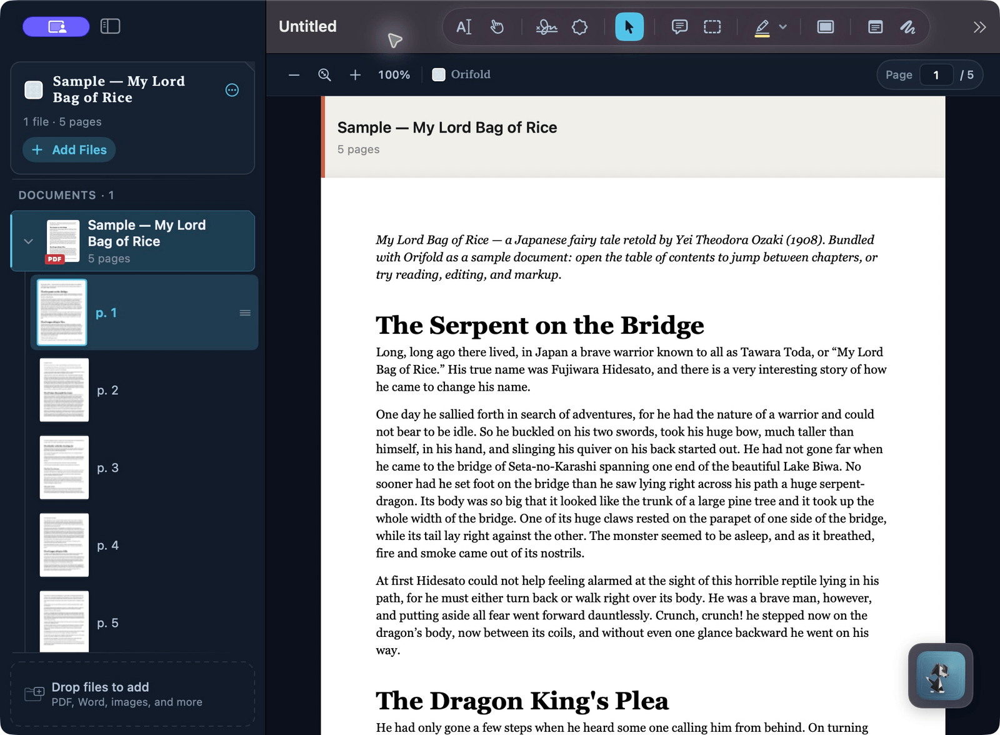

<p align="center">
  <picture>
    <source media="(prefers-color-scheme: dark)" srcset="docs/assets/orifold-wordmark-dark.svg">
    
  </picture>
</p>

<h1 align="center">Many files. One clear PDF.</h1>
<p align="center">A free, local-first PDF workspace for Mac.</p>

<p align="center">
  <a href="https://github.com/udhawan97/Orifold/releases/latest/download/Orifold.dmg"> <strong>Download for Mac ↓</strong></a>&nbsp; · &nbsp;
  <a href="https://udhawan97.github.io/Orifold/">Explore Orifold</a>&nbsp; · &nbsp;
  <a href="https://udhawan97.github.io/Orifold/get-started/first-workspace/">First steps</a>
</p>

<p align="center">
  
  
  <a href="https://github.com/udhawan97/Orifold/releases/latest"></a>
  <a href="LICENSE"></a>
  
</p>

Arrange the pages, mark up the draft, and search the scan in one native workspace.
Document processing runs on your Mac. No Orifold account or subscription is required.

> [!IMPORTANT]
> **Open-source beta.** Keep your originals and reopen an exported copy before sharing
> important paperwork. Form-answer saving remains under investigation, and moving the last
> page of a source does not yet have verified attachment transfer. Read the [current limits](#current-limits).

## Choose how to start

| Your Mac | Start here | What to expect |
| --- | --- | --- |
| macOS 14+ · Apple Silicon or Intel | **[Download the universal DMG](https://github.com/udhawan97/Orifold/releases/latest/download/Orifold.dmg)** | Open it, drag Orifold into Applications, then follow the [first-launch guide](https://udhawan97.github.io/Orifold/get-started/install/). |
| Prefer an archive | [Download Orifold.zip](https://github.com/udhawan97/Orifold/releases/latest/download/Orifold.zip) | The same universal app in a ZIP. |
| Prefer Terminal or Homebrew | [Install options](#install) | Prebuilt download; no Xcode needed. |
| Want to work on the source | [Build instructions](#under-the-hood) | macOS and Apple’s development tools are required. |

Public builds are **ad-hoc signed and not Apple-notarized** unless the release states otherwise.
macOS may require approval in Privacy & Security on first launch. Check the version, assets,
and SHA-256 checksums on the [latest release page](https://github.com/udhawan97/Orifold/releases/latest).
Orifold is a macOS app; Windows, Linux, and browser editions are not shipped.

## What it does

| Your task | In Orifold |
| --- | --- |
| **Make one packet** | Import PDFs, images, and supported office/text files. Reorder, rotate, crop, and arrange pages, then export a combined PDF. Office files are converted to PDF rather than edited in their native format. |
| **Review a draft** | Highlight, comment, add notes or ink, place visual signatures, and compare the visible working draft against another PDF. |
| **Make a scan searchable** | Run on-device Vision OCR, inspect its result and partial-success report, then search the new text layer. |
| **Prepare a copy to share** | Compress, select a booklet or multi-page layout, sanitize metadata and attachments, or encrypt a PDF with an AES-256 password. |
| **Adjust compatible content** | Visually replace detected text or edit supported page graphics. These beta tools have different limits from permanent redaction. |
| **Read comfortably** | Use Contents, Read Aloud, Reader Mode, and Document Comfort. On macOS 15+, translate a selection or page on-device after any required Apple language-model download. |

The app supports **English, Español, Français, हिन्दी, 日本語, and 简体中文**.
The documentation is currently in English. [Browse the complete guide](https://udhawan97.github.io/Orifold/get-started/workflows/).

<p align="center">
  <a href="docs/assets/screenshots/workspace-v0-12-2.png"></a>
</p>
<p align="center"><sub>Actual source-build capture, using the bundled fictional sample. See <a href="docs/assets/MEDIA_MANIFEST.md">capture provenance</a>.</sub></p>

## Your first PDF

1. Open **Orifold**, choose Gami or Ori, and click **Open sample document** for a disposable five-page tour.
2. For your own work, import up to **50 files per batch**. Add another batch after the first finishes.
3. Arrange the documents and pages. Add markup or OCR when you need it.
4. Choose **File → Export** (⌘E), save a copy, then reopen it and check the pages, text, forms, and attachments you need.

Merging is the workspace: arrange first, export once. The [first-workspace guide](https://udhawan97.github.io/Orifold/get-started/first-workspace/) walks through the controls.

## Privacy

PDF import, editing, OCR, compression, and export run locally. Orifold has no document-processing
server, account system, or analytics pipeline. Preferences and recent-file information stay locally
in the app’s own storage.

There are three explicit network boundaries:

- **Updates:** GitHub release metadata and downloads. Automatic checks are off by default; downloading and installing require your action.
- **Optional signing timestamp:** an RFC 3161 request sends a hash of signature bytes. Current builds warn and export PAdES B-B rather than embedding an unverified timestamp candidate.
- **Translation:** macOS may download an Apple language model before translation runs on-device.

The sandbox permits user-selected files and remembered app-scoped bookmarks, plus outbound
network access. It does not enforce a per-host network allowlist. [Read the privacy details](https://udhawan97.github.io/Orifold/settings/privacy/).

## Current limits

- **Incoming attachments:** the preferred PDF import path removes existing embedded files during hardening; a compatibility fallback can retain them. Keep the original and extract needed files before import, then deliberately add them through **Inspector → Attachments**. Check the resulting inventory. Attachments added in Orifold survive normal save/export; **Sanitize for sharing** removes them.
- **Forms:** page moves between source documents refuse form-bearing input before mutation. Reader Mode form-answer serialization remains under investigation; reopen a saved copy and verify answers before relying on it. [Form limits](https://udhawan97.github.io/Orifold/fill-sign/forms/#current-limits).
- **Page moves:** cross-document moves refuse affected sources with committed inline-text edits. A source’s final page also stays put when its attachment catalog is present or its absence cannot be verified. Other document-level catalog transfer remains unverified; keep originals and inspect the output. [Page-move boundaries](https://udhawan97.github.io/Orifold/import/organize-pages/#preserve-source-documents).
- **Visual text replacement:** original text may remain searchable, copyable, extractable, or available to assistive technology. Use the separate beta **Redact** tool for supported permanent removal; unsupported boundaries are refused. [Redaction guide](https://udhawan97.github.io/Orifold/edit/redact/).
- **Conversions and layout:** imported Office/text documents become PDFs. Reflow, DOCX, image output, and booklet layouts have format-specific limitations; inspect the result in the viewer or printer you will use.
- **Verification:** source tests and CI do not establish complete native VoiceOver, printing, installed-app update/restore, or notarization acceptance. This release series remains beta.

Report a reproducible problem through [GitHub Issues](https://github.com/udhawan97/Orifold/issues), using a fictional or redacted sample.

## Install

The prebuilt installer downloads the latest release into `~/Applications/Orifold.app`:

```zsh
curl -fsSL https://raw.githubusercontent.com/udhawan97/Orifold/main/install.sh | zsh
```

Review the script before running it if desired. It clears the downloaded app’s quarantine;
use the manual DMG route if you prefer macOS’s normal first-launch approval flow.

<details>
<summary>Homebrew, updates, and removal</summary>

```zsh
brew tap udhawan97/orifold https://github.com/udhawan97/Orifold
brew install --cask udhawan97/orifold/orifold
brew upgrade --cask --greedy udhawan97/orifold/orifold
```

Choose **Orifold → Check for Updates…** for an explicit check. Automatic swapping and the
standalone restore helper require eligible trusted signed builds; development/ad-hoc builds
use the manual disk-image path. Installed Desktop helpers are another deliberate update option.

The uninstaller first asks Orifold to quit. Cancelling that quit stops removal. To remove the
app while preserving preferences, caches, and sandbox data:

```zsh
curl -fsSL https://raw.githubusercontent.com/udhawan97/Orifold/main/scripts/uninstall-mac.sh | zsh -s -- --keep-user-data
```

[Update, restore, and uninstall guide](https://udhawan97.github.io/Orifold/get-started/update-uninstall/).

</details>

## A little company

Gami and Ori are optional paper companions. Choose one, switch later, or hide the buddy from
the app menu. The crane, the dog, and the cat use the same folded-paper geometry as the app.

<p align="center">&nbsp;&nbsp;</p>

## Under the hood

SwiftUI and PDFKit provide the native workspace; bundled PDFium and qpdf handle document
analysis and structural transformations. SwiftPM is the shipping build. XcodeGen creates the
Xcode project used for development and CI validation.

<details>
<summary>Build, test, and contribute</summary>

```zsh
git clone https://github.com/udhawan97/Orifold.git
cd Orifold
swift build
swift test
```

For a universal package without installing it:

```zsh
ORIFOLD_UNIVERSAL=1 ./scripts/install-mac.sh --clean --no-open --package-only --package /tmp/Orifold.zip
```

Use macOS and Apple Command Line Tools with Swift 6.1+. The test and package commands use
local system frameworks; read the [release gate](https://udhawan97.github.io/Orifold/developers/release-gate/) for the hosted Xcode configuration and separate manual acceptance checks.

- [CONTRIBUTING.md](CONTRIBUTING.md) · [Domain vocabulary](CONTEXT.md)
- [Architecture](https://udhawan97.github.io/Orifold/developers/architecture/) · [Roadmap](https://udhawan97.github.io/Orifold/developers/roadmap/)
- [Release notes](https://udhawan97.github.io/Orifold/releases/) · [Source changelog](docs/release-v0.12.2.md)

</details>

Licensed under [Apache 2.0](LICENSE). One sheet, folded into flight.
